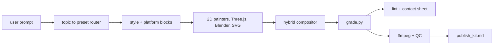

# Plan v2: Art Direction + Creator-Grade Output for Monetised, Multi-Platform Content

## Goal Description
Make the pipeline produce content that looks authored, not like AI slop. It should also follow current practice on YouTube (Shorts and long form), TikTok, Reels and similar platforms. It should handle any subject the prompt gives it, from "horse tinder" to international politics.

**Findings:**
- `projects/on_children` shows what good looks like in this repo: one palette, one material language, one typeface, and bespoke 3D and SVG. The engine defaults (the neon-on-navy showcase and the stock subtitle pill) read as generic template output.
- The engine has no encoded art direction and no platform or retention logic. It has no hook structure, caption styling, safe-zone presets per platform, or monetisation checks.

**Decisions made from your answers:**
- Your answers: use popular practice, target all monetised platforms, and cover a flexible range.
- My defaults for the unanswered questions: motion is **punchy for short-form and calm for essays**, chosen per format preset. The existing `examples/` stay untouched and new reference boards are added. Change either if you disagree.

## User Review Required
> [!IMPORTANT]
> **Monetisation and originality.** YouTube's "inauthentic/reused content" and AI-disclosure rules and TikTok's labeling rules apply. The plan adds checks and a generated metadata sheet, but no tool can guarantee monetisation approval. Policies change, so I'll cite the current policy pages in the docs and mark them as "verify before publishing".

> [!WARNING]
> **Political and sensitive topics.** The politics board will be a neutral, sourced explainer template. It requires an on-screen source for every factual claim and labels opinion as opinion. The pipeline will not generate persuasive or deceptive political content, such as fake quotes or fabricated footage.

> [!NOTE]
> New optional `style` and `platform` blocks. Existing boards are unaffected.

## Proposed Changes

### 1. Style bible (the `style` block)
- **[NEW] `schemas/style.schema.json`**, **[MODIFY] `storyboard.schema.json`**, **[MODIFY] `scripts/storyboard.py`**: an optional `style` block that sets palette roles (60/30/10), type (OFL families), material, light, grade, and motion.
- **[NEW] `scripts/style.py`**: resolves a preset or inline block. Painters, the Three.js bridge and Blender all read from it.
- **[NEW] `assets/styles/*.json`**, presets picked by common creator looks:
  | Preset | Popular look | Fits |
  | :--- | :--- | :--- |
  | `soft_clay` | pastel 3D clay or paper (extracted from `On Children`) | poetry, wellness, storytelling |
  | `punchy_pop` | bold flat colour, thick outlines, high contrast, sticker-style captions | comedy, lifestyle, memes (horse tinder) |
  | `newsroom_clean` | restrained dark or light, a single accent, map and data-forward, lower-thirds | politics, explainers, finance |
  | `noir_restraint` | cinematic, low-key, one accent | true crime, history, documentary |
  | `risograph` | two-ink print texture, offset misregistration | culture, essays |
  | `tech_blueprint` | schematic line work | tech, code, science |

### 2. Cross-backend finishing (unifies Three.js, Blender, SVG and 2D)
- **[NEW] `scripts/grade.py`**: the shared colour grade, seeded deterministic grain, vignette, halation, and optional paper texture. It runs after compositing for every backend.
- **[MODIFY] `elements/svg.py` and `hybrid_compositor.py`**: `style_match` for SVG gives palette tinting, a slight hand-drawn wobble, a multiply or soft-light blend and contact shadows.
- **[MODIFY] `threejs/scenes.mjs`, `runner.mjs` and `blender_runner.py`**: shared tone mapping, colour-temperature lights and material families driven by `style`, so a plate from either engine matches.

### 3. Platform and retention layer (the creator-practice part)
- **[NEW] `schemas/platform.schema.json`** and **[NEW] `scripts/platform.py`**: a `platform` block with presets `shorts_tiktok_reels` (9:16, 1080×1920), `youtube_long` (16:9), and `square` (1:1). Each sets:
  - **Safe zones** per platform UI (caption/UI overlap areas), reusing `canvas.safe_rect` and `layout_zones`.
  - **Hook rules:** a payoff or question inside the first 1–3 s, with text on frame 0. A lint warns if the first beat is a title card or logo.
  - **Pacing:** a visual change every 1.5–3 s for shorts (the `Beat density` already in `archetypes.md`), longer holds for essays, and a loop-friendly ending for shorts.
  - **Captions:** large burned-in captions with word-level highlight, using the existing `words[]` timings, placed in the safe zone. Short-form presets use keyword emphasis, and long-form uses editorial captions.
  - **Audio:** the existing −14 LUFS target. Music ducking under VO, with sidechain-style ducking from `audio_dsp.py`.
- **[MODIFY] `scripts/render_engine.py`**: reads the platform and style blocks and applies the caption and safe-zone presets. The 9 gates, ffprobe QC and the memory trimming stay as is.
- **[NEW] `scripts/publish_kit.py`**: from a board, writes `publish_kit.md` with title and description draft, a chapter list (long form), asset **credits from `assets/manifest.json`** (the existing `attribution` strings), AI-disclosure wording, and a thumbnail pick. The thumbnail is chosen from candidate frames by a simple contrast and face-free focal score, and is not claimed to be "best".

### 4. Motion and composition
- **[MODIFY] `camera.py`, `easings.py`, `scene_router.py`**: motion presets with parallax drift between layers, holds on key beats, and anticipation/overshoot. `punchy` means fast, snappy and quick cuts, and `calm` means slow drift.
- **[NEW] `scripts/composition.py`**: thirds and golden-ratio anchors, negative space, and an off-centre hero by default.
- **[MODIFY] `elements/text.py`**: editorial and sticker-style caption variants, with no default pill.

### 5. Lint and review tooling
- **[NEW] `scripts/style_lint.py`** flags:
  - off-palette or more than 3 saturated hues;
  - over-use of glow;
  - repeated centred composition;
  - default-font fallback;
  - flat scenes with no depth layering;
  - a single easing used everywhere;
  - no hook in the first 3 s (platform presets);
  - claims without a source (for the `newsroom_clean` preset);
  - assets without attribution.
  - It runs in report mode by default, with `--strict` available.
- **[NEW] `scripts/contact_sheet.py`**: one labelled tile per scene, for fast visual review.
- **[MODIFY] `scripts/ci_gates.sh`**: runs the lint on examples in report mode.

### 6. New reference boards (range, each mixing Three.js, Blender, SVG and 2D)
Each is a ~20–45 s example with offline-safe assets and no real persons' likeness or quotes.
| Board | Format | Style | Shows |
| :--- | :--- | :--- | :--- |
| **[NEW] `examples/ref_horse_tinder.json`** | 9:16 short | `punchy_pop` | Comedy hook ("swipe right on a stallion"), profile-card UI built from SVG and 2D, a 3D horse/hoof prop plate, a swipe animation, a sticker-caption reveal and a loop ending. |
| **[NEW] `examples/ref_geopolitics_explainer.json`** | 16:9 long-form chapter | `newsroom_clean` | Neutral explainer, an SVG map with animated routes, a data chart, lower-third source cards on every claim, a Three.js globe plate and an opinion/fact label. |
| **[NEW] `examples/ref_true_story_noir.json`** | 9:16 or 16:9 | `noir_restraint` | Documentary pacing, a slow camera, one accent. |
| **[NEW] `examples/ref_tech_explainer.json`** | 9:16 | `tech_blueprint` | A code/system explainer using existing archetype elements and the new style. |
| **[NEW] `examples/ref_soft_clay_poem.json`** | 16:9 | `soft_clay` | A trimmed version of the `On Children` approach, as the "calm" reference. |

- **[MODIFY] `references/storyboard-guide.md`, `references/archetypes.md`, `SKILL.md` (≤120 lines)**, **`docs/project-plan.md`, `CHANGELOG.md`**: an "Art direction and platform practice" chapter, the anti-slop checklist, policy links, and a **topic → preset → board** decision table so a prompt such as "horse tinder" or "international politics" maps to a starting point.



## Delivery order (each phase independently shippable)
1. `style.py`, schema and presets (`soft_clay` and `punchy_pop` first), with painters reading the palette.
2. `grade.py` and SVG `style_match`.
3. `platform.py`: captions, safe zones, hook and pacing presets.
4. Three.js and Blender parity, plus motion and composition.
5. Lint, contact sheets and `publish_kit.py`.
6. The five reference boards and the docs.

## Verification Plan
### Automated Tests
```bash
.venv/bin/python -m pytest tests/ -q          # existing 395 stay green; new tests added
.venv/bin/ruff check --no-cache scripts/ tests/ && .venv/bin/ruff format --check --no-cache scripts/ tests/
.venv/bin/mypy scripts/
check-jsonschema --check-metaschema schemas/*.schema.json
bash scripts/ci_gates.sh
for b in examples/ref_*.json; do python3 scripts/storyboard.py $b; python3 scripts/render_engine.py --storyboard $b --thumbnails /tmp/sm_$(basename $b .json); done
```
New tests (no golden PNGs): style and platform schema parity, deterministic grain, pixel-statistics smoke (palette proximity, no clipping), lint rules on crafted boards, caption placement inside safe zones, `publish_kit` output, and that unsourced political claims are flagged.

### Manual Verification
- I will render a draft MP4 of each reference board and show you contact sheets, including before/after against the current showcase.
- You judge the look and the humour. Taste is your call, so I'll iterate from your notes.

## Risks
- "Popular practice" shifts quickly. Presets are data files, so they are easy to tweak, and the docs mark them as current as of this date.
- Politics: the neutrality and sourcing guardrails above are a deliberate scope limit.
- A 3D horse needs an asset or procedural model. I will use a stylised procedural or licensed asset (via `fetch_assets.py`) and fall back to SVG if neither is available.
- The grade pass adds per-frame cost, so I'll measure it and cache grain tiles and LUTs.
